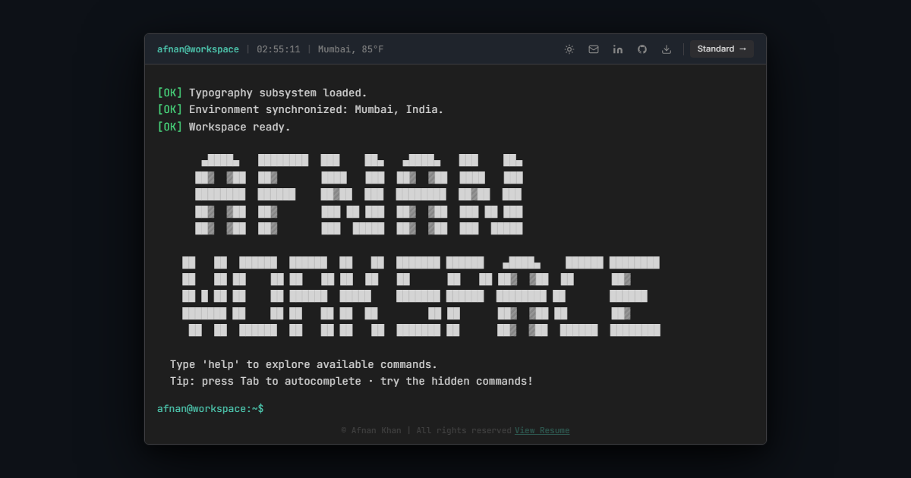

# Afnan Workspace — Developer Portfolio

> Open files. Run commands. Play the arcade. Experience my portfolio through a VS Code–inspired workspace.

[](https://afnanlabs.github.io/afnan-workspace/)
[](https://react.dev)
[](https://www.typescriptlang.org)
[](https://vite.dev)



---

## What is this?

Afnan Workspace is my personal portfolio, built around the experience of VS Code instead of a traditional landing page. It ships **two interfaces** that share one content layer:

- **Terminal View** (default on desktop) — a fully typed command interface. Run `help`, browse `projects`, `open` a repository, or launch a game.
- **Standard View** — a VS Code–styled editor with an Explorer, tabs, a working menubar, a command palette, search, settings and a live status bar.

There is also a small **retro arcade** hidden inside (`arcade`, `snake`, `tetris`, `galaga`, `pacman`) complete with persistent high scores.

---

## Highlights

### Terminal View

A command-line portfolio powered by a small shell engine. Type `help` to see everything, or try:

| Command | What it does |
| --- | --- |
| `about` · `experience` · `projects` · `skills` · `education` | Browse my profile data |
| `languages` · `certs` · `contact` · `resume` | Languages, certifications, contact, résumé download |
| `open hrms` · `open thinktrack` · `open afnkit` | Jump straight into a project |
| `open codeglow` · `open somnus` · `open fitscore` | …and the rest of the project list |
| `standard` · `terminal` · `code` | Switch views from the keyboard |
| `neofetch` · `whoami` · `stats` · `uptime` · `date` | System-style info |
| `banner` · `ascii` · `fortune` · `cowsay` · `coffee` | The fun ones |
| `sounds` · `clear` · `reset` · `history` · `pwd` · `ls` | Session utilities |
| `arcade` · `snake` · `tetris` · `galaga` · `pacman` · `scores` | Play & view leaderboards |

### Built-in Arcade

| Feature | Description |
| --- | --- |
| Four games | Snake, Tetris, Galaga and Pac-Man |
| Pause & resume | Press `P` or `Esc` in any game |
| High scores | Per-game personal bests persisted in `localStorage` |
| Leaderboard | The `scores` command and the arcade lobby show your bests |
| Sound | Optional chiptune SFX that respect the global sound toggle |
| Touch controls | Swipe + on-screen D-pad / buttons on mobile (coarse pointers only) |
| Lazy-loaded | Each game is code-split and only fetched when opened |

### VS Code Realism (Standard View)

| Feature | Description |
| --- | --- |
| Explorer & tabs | Folder tree with file icons and a real tab bar |
| Functional menubar | `File · Edit · View · Go · Run · Terminal · Help` with working actions |
| Command palette | `Ctrl/Cmd + Shift + P`, fuzzy search over commands and files |
| Quick Open | `Ctrl/Cmd + P` file finder |
| Search panel | Workspace-wide, grouped results that open the matching file |
| Settings panel | Theme (dark / light / system) and interface-sound toggles |
| Live status bar | Selection count, line count, language, branch and a live clock |

### Quality & Reach

- **SEO ready** — canonical URL, Open Graph + Twitter cards, and `Person` JSON-LD structured data.
- **Crawlable** — `robots.txt` and `sitemap.xml`.
- **Installable PWA** — web app manifest plus an offline-first service worker.
- **Privacy-first analytics** — Do-Not-Track / Global Privacy Control aware; completely silent unless `VITE_ANALYTICS_ENDPOINT` is configured at build time.
- **Fast** — component-level code splitting keeps the arcade and command palette out of the initial bundle.
- **Typed & tested** — strict TypeScript and a Vitest unit-test suite.

---

## Tech Stack

| Layer | Tools |
| --- | --- |
| UI | React 19, Tailwind CSS v4, lucide-react icons |
| Language | TypeScript 5.9 (strict) |
| Build | Vite 7 |
| Command palette | cmdk |
| Audio | Web Audio API (no audio files) |
| Storage | `localStorage` for high scores, theme and sound preferences |
| Testing | Vitest + happy-dom |
| Hosting | GitHub Pages via GitHub Actions |

> The `src/components/ui` folder contains shadcn/ui scaffolding that is available but not wired into the app; the interface is hand-built.

---

## Project Structure

```text
.
├── public/
│   ├── Afnan_Khan_Resume.pdf
│   ├── faviconAK.png
│   ├── terminal-view.png        # social / README preview
│   ├── icon.svg                 # PWA icon
│   ├── manifest.webmanifest
│   ├── robots.txt
│   ├── sitemap.xml
│   └── sw.js                    # offline service worker
│
├── src/
│   ├── components/
│   │   ├── standard/            # VS Code-style editor view
│   │   ├── terminal/            # terminal view + arcade games
│   │   └── ui/                  # shadcn/ui scaffolding
│   ├── data/                    # content + command definitions
│   ├── hooks/                   # audio, cursor, draggable, mobile
│   ├── lib/                     # arcade store, analytics, résumé helpers
│   ├── test/                    # test setup
│   ├── App.tsx
│   ├── main.tsx
│   └── index.css
│
├── .github/workflows/deploy.yml # Pages deploy
├── index.html
├── vite.config.ts
├── vitest.config.ts
├── package.json
└── tsconfig*.json
```

---

## Getting Started

### Prerequisites

- Node.js **20.19+** or **22.12+** (Vite 7 requirement) and npm.

### Install

```bash
git clone https://github.com/afnanlabs/afnan-workspace.git
cd afnan-workspace
npm install
```

### Develop

```bash
npm run dev        # start the dev server
npm run build      # type-check + production build
npm run preview    # preview the production build locally
npm run test       # run the unit tests once
npm run test:watch # run tests in watch mode
npm run typecheck  # type-check without emitting
```

### Keyboard Shortcuts (Standard View)

| Shortcut | Action |
| --- | --- |
| `Ctrl/Cmd + P` | Quick Open |
| `Ctrl/Cmd + Shift + P` | Command Palette |
| `Ctrl/Cmd + B` | Toggle sidebar |
| `Ctrl/Cmd + Shift + E` | Explorer |
| `Ctrl/Cmd + Shift + F` | Search |
| `Ctrl/Cmd + Shift + G` | Source Control |
| `Ctrl/Cmd + Shift + X` | Extensions |
| `Ctrl/Cmd + ,` | Settings |
| `D` | Toggle theme |
| `P` / `Esc` | Pause or resume an arcade game |

---

## Deployment

Pushes to `master` trigger the GitHub Actions workflow in `.github/workflows/deploy.yml`, which builds the site and publishes it to GitHub Pages at:

**https://afnanlabs.github.io/afnan-workspace/**

The Vite `base` is set to `/afnan-workspace/` to match the Pages sub-path. Views are deep-linkable via the URL hash, e.g. `#mode=terminal`, `#mode=standard`, or `#mode=standard&file=hrms`.

---

## Connect With Me

Built by **Afnan Khan** — Full-Stack Developer.

- LinkedIn: https://linkedin.com/in/afnankhan1108-dev
- GitHub: https://github.com/afnanlabs
- Email: khanafnan1108@gmail.com

---

### "Building practical applications, interactive experiences, and continuously improving through hands-on development."
